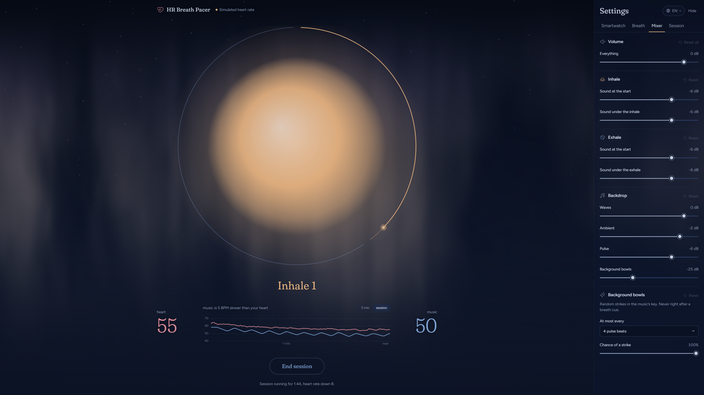
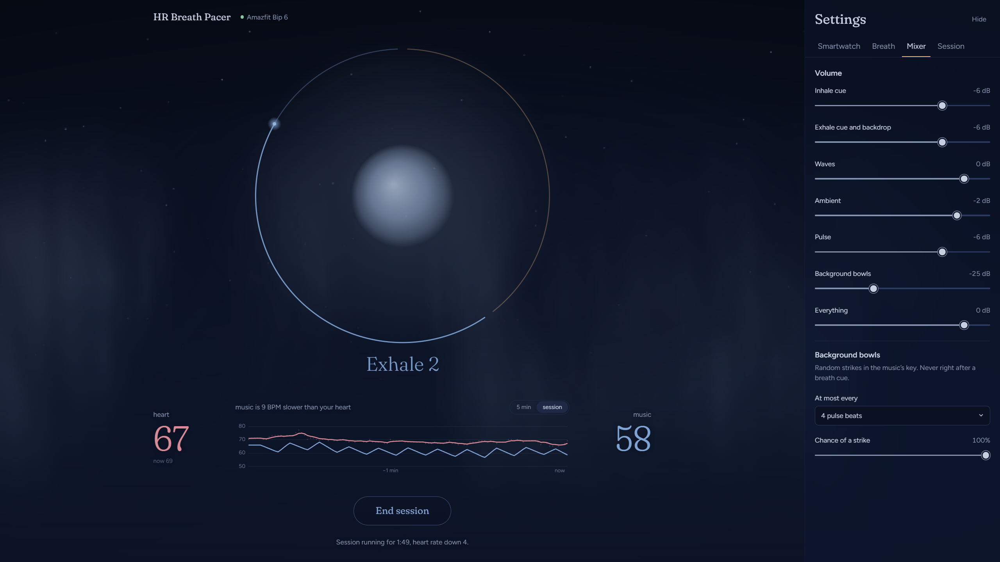
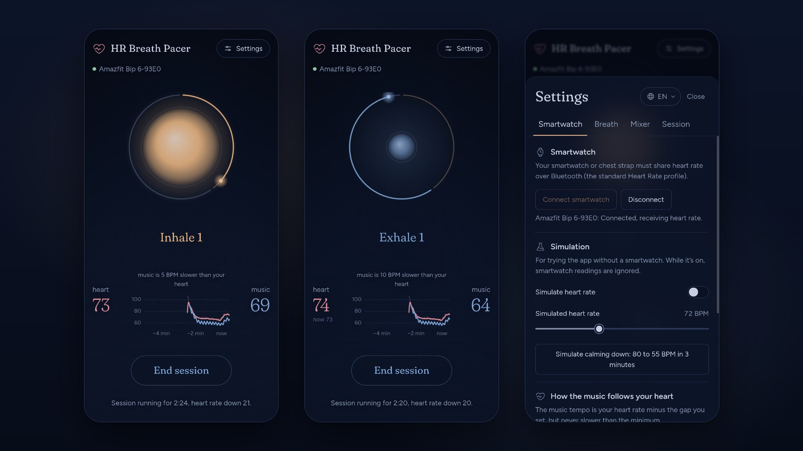

  

<h1 align="center">HR Breath Pacer</h1>

Calming music driven by your heart rate.

  <a href="https://hr-breathe.maciejbiel.pl"><strong>Open the app at hr-breathe.maciejbiel.pl</strong></a>
   
  Chrome on a computer or an Android phone. Installable to your home screen.

 

It **reads your pulse live** from a Bluetooth smartwatch, plays **generative ambient music** a few beats per minute slower than your heart, and paces your breathing with a cue at the start of every inhale and exhale (4 in, 6 out by default). Your heart tends to follow the music down.

## What you need

- Chrome or Edge on a computer or Android. Safari, Firefox and iPhones don't support Web Bluetooth.
- A smartwatch or chest strap that shares heart rate over Bluetooth (the standard Heart Rate profile). No device? The app has a built-in heart rate simulation.

## License

[MIT](LICENSE)
